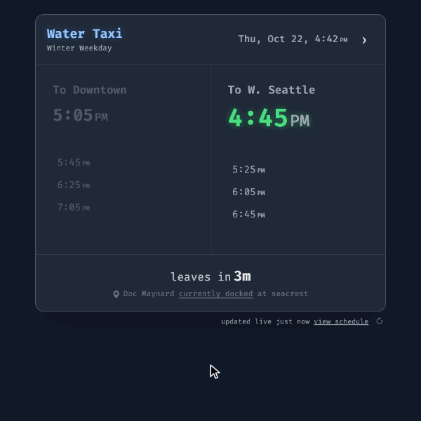
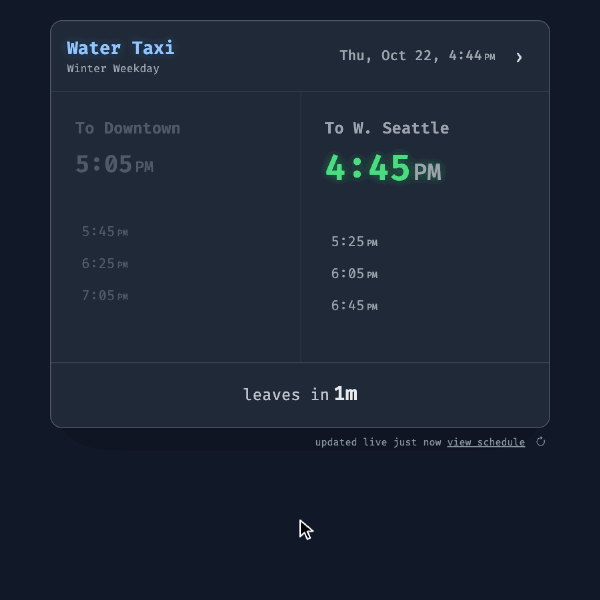

# `hanstaxi`

When's the next West Seattle water taxi? The next sailing each way, a countdown to departure, and where the boat is right now.

  
[<kbd> haaans.com/hanstaxi  </kbd>](https://haaans.com/hanstaxi/)

## Features

<table>
<tr valign="top">
<td width="50%">
<h3>Pick your direction</h3>

Click To Downtown or To W. Seattle and that side takes the lead. The countdown and live boat status follow it.

</td>
<td width="50%">

</td>
</tr>
<tr valign="top">
<td width="50%">

</td>
<td width="50%">
<h3>Look ahead a day</h3>

Step forward to see a future day's full schedule, weekday or weekend. The arrow takes you straight back to today.

</td>
</tr>
<tr valign="top">
<td width="50%">
<h3>Jump to any date</h3>

Click the date to open a calendar and pick a day. That day's schedule loads in place.

</td>
<td width="50%">

</td>
</tr>
<tr valign="top">
<td width="50%">

</td>
<td width="50%">
<h3>Add a sailing to your calendar</h3>

Hover any time and click the calendar icon. The event it creates covers the trip with a buffer on each side, ready for Google Calendar.

</td>
</tr>
</table>
